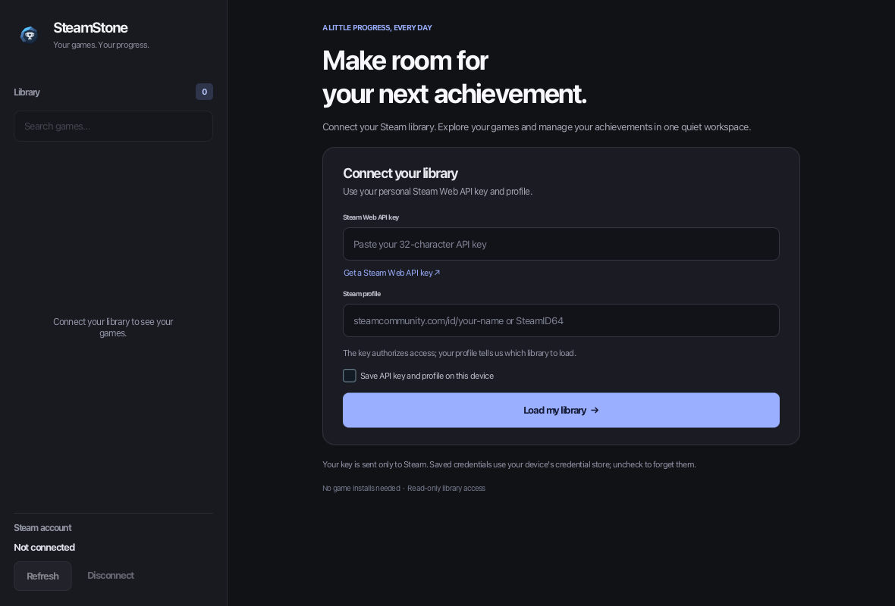

# SteamStone

**Your games. Your progress.** A desktop app for browsing your Steam library and staging achievement changes before saving them to Steam.

[Downloads](https://github.com/arya2004/SteamStone/releases/latest) · [User guide](docs/guide.md) · [Website](https://arya2004.github.io/SteamStone/) · [Report a bug](https://github.com/arya2004/SteamStone/issues/new/choose)

## What it does

- Browse and search your Steam library.
- Preview individual or bulk achievement changes; **Reset** discards the preview.
- Use **Save changes** to send edits to Steam, with confirmation and partial-result feedback.
- Optionally save one API key and profile in your operating system's credential store and reconnect on startup.
- Use native macOS menus, keyboard shortcuts, and vertical game-list scrolling.

Browsing and checkbox changes never save achievements automatically. Steam must be running under the same account to edit achievements. Some games restrict changes; this app cannot guarantee compatibility or protection from game-specific consequences.

## Download

Choose an asset from the [latest published release](https://github.com/arya2004/SteamStone/releases/latest). **Java is included.** The repository ZIP contains source code, not a runnable app.

| Computer | Download | Open |
| --- | --- | --- |
| macOS Apple Silicon | `SteamStone-<version>-macos-arm64.zip` | Extract and move SteamStone.app to Applications |
| macOS Intel | `SteamStone-<version>-macos-x64.zip` | Extract and move SteamStone.app to Applications |
| Windows x64 | `SteamStone-<version>-windows-x64-setup.exe` | Run the per-user setup wizard |
| Windows x64, portable | `SteamStone-<version>-windows-x64.zip` | Extract the whole folder; run SteamStone.exe |
| Linux x64 | `SteamStone-<version>-linux-x64.tar.gz` | Extract; run SteamStone/bin/SteamStone |

Windows and Linux archives must remain together with their bundled runtime. Linux requires a graphical desktop and GTK 3. Builds have no trusted publisher signature and are not notarized; OS warnings are expected. See [installation and verification](docs/guide.md#installation).

**v1.0.0 is being prepared, not yet published.** Apple Silicon packaging and fixture checks have passed locally; Intel Mac, Windows, and Linux still require runtime and installation verification.

## First-time setup

1. Open Steam and sign into your account.
2. Get a personal key from [Steam's API key page](https://steamcommunity.com/dev/apikey), also linked inside the app. Follow Steam's current registration requirements.
3. Paste the key and enter your Steam profile URL or SteamID64 for that same account.
4. Optionally select **Save API key and profile on this device**.
5. Click **Load my library** and choose a game.

Without saving, credentials stay in memory for the session. Saved credentials use macOS Keychain, Windows Credential Manager, or a supported Linux keyring; there is no plaintext-file fallback. To forget them, disconnect and uncheck the save option. Disconnect alone does not erase a remembered account. SteamStone does not discover profiles from a key; it stores only the profile you supply.

## Edit achievements

Tick or untick to stage an unlock or lock. **Unlock all / Lock all** stage changes for available achievements in the selected game. **Reset** discards uncommitted edits. **Save changes** applies the preview through Steam. Reload, switching games, and closing ask before discarding unsaved edits; navigation is blocked during a save.

If a save is not confirmed, reload before retrying: accepted changes may still sync. Partial results keep unresolved intentions in the preview. Unavailable achievements remain read-only. Details and recovery steps are in the [user guide](docs/guide.md).

## Contribute and report problems

See [CONTRIBUTING.md](CONTRIBUTING.md) for builds and tests, [SECURITY.md](SECURITY.md) for sensitive reports, and [CODE_OF_CONDUCT.md](CODE_OF_CONDUCT.md) for community guidelines. Include your app version, OS, architecture, and reproduction steps in bug reports. Never include API keys or saved credentials.

## License and credits

SteamStone is [MIT licensed](LICENSE.md), inspired by [Steam Achievement Manager](https://github.com/gibbed/SteamAchievementManager), and built with JavaFX and [steamworks4j](https://github.com/code-disaster/steamworks4j). Dependencies retain their own license terms.

SteamStone is not affiliated with or endorsed by Valve. Steam names and game artwork belong to their owners.
